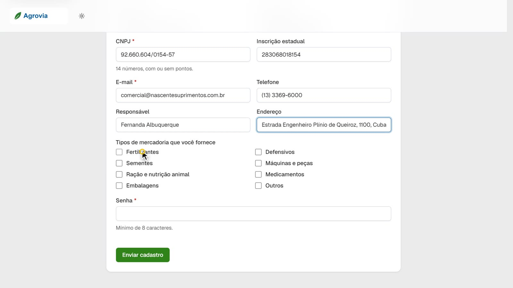
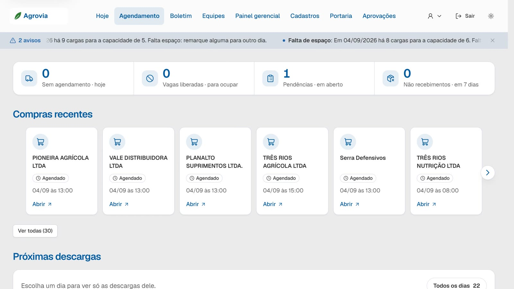
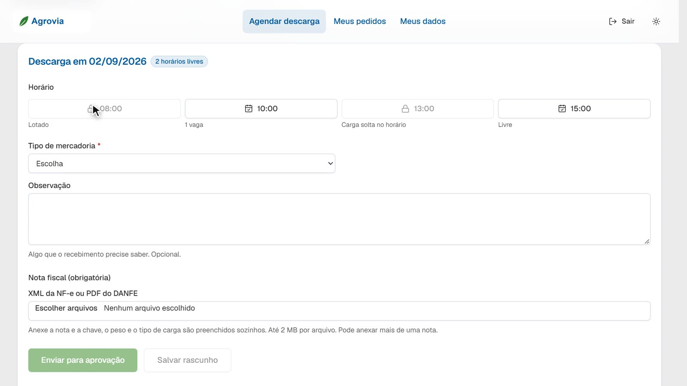
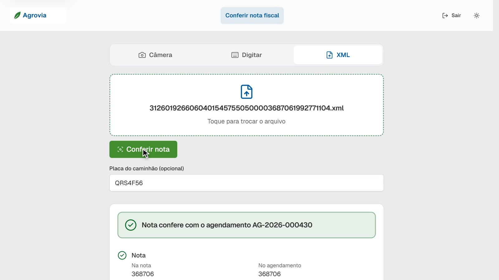
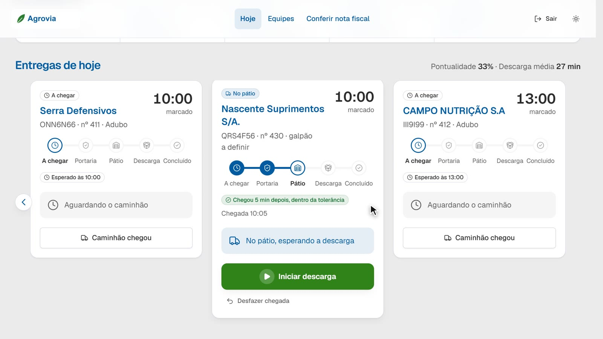
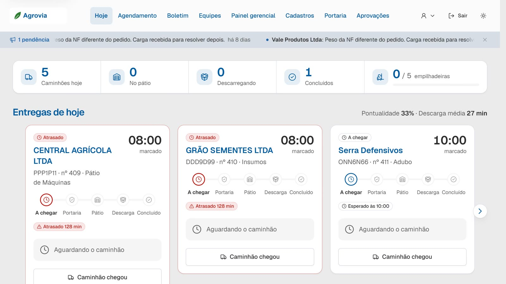
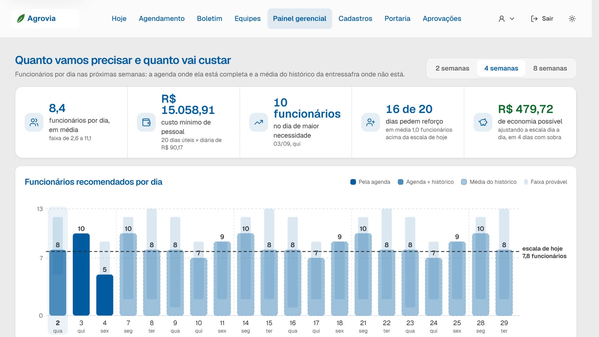
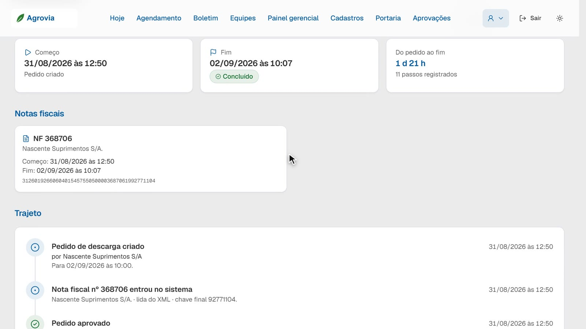

<div align="center">

# Recebimento Inteligente

**Do cadastro do fornecedor à saída do caminhão, tudo registrado no mesmo lugar.**

Sistema web para agendar, conferir e controlar o recebimento de cargas em armazéns agro,
com painel que projeta quantos funcionários cada dia vai exigir e quanto isso custa.

[](docs/media/demo-recebimento-inteligente.mp4)

▶ **[Assistir à demonstração (5 min)](docs/media/demo-recebimento-inteligente.mp4)** · todos os nomes e dados do vídeo são fictícios


</div>

---

## O problema

Em muitos recebimentos de carga, o caminhão chega sem avisar, a nota fiscal é conferida no olho na
guarita e ninguém sabe, de véspera, quantas pessoas escalar. O resultado é fila, divergência
descoberta tarde e equipe sobrando num dia e faltando no outro.

## O que o sistema faz

| Etapa | Quem usa | O que acontece |
|---|---|---|
| **1. Cadastro** | Fornecedor | Se cadastra sozinho por um link e define a própria senha. |
| **2. Aprovação** | Compras | Confere CNPJ, contato e mercadoria e aprova o acesso. |
| **3. Agendamento** | Fornecedor | Vê só os dias e horários com vaga, anexa o XML da NF-e e a chave, o peso e o tipo de carga são lidos sozinhos. |
| **4. Aprovação do pedido** | Compras | Vê a nota já conferida (emitente, valor, peso e itens) e aprova. |
| **5. Portaria** | Portaria | Lê a nota (câmera, chave ou XML) e confere contra o agendamento antes de o caminhão entrar. Registra placa e peso da balança. |
| **6. Descarga** | Armazém | Define o galpão, cronometra a descarga e registra funcionários e equipamentos usados. |
| **7. Gestão** | Direção | Visão do dia, agenda, boletim diário, escala de equipes, painel gerencial e auditoria completa. |

### O painel gerencial

Responde à pergunta que a operação não conseguia responder: **a equipe sobra ou falta?**

- Projeta funcionários por dia para as próximas semanas, usando a agenda onde ela está completa e a média do histórico onde não está.
- Calcula o custo mínimo de pessoal e a economia possível ao ajustar a escala.
- Mostra excesso e falta médios, em funcionários e em reais, por período e por armazém.

## Telas

| | |
|---|---|
|  |  |
| **Cadastro do fornecedor.** Link único, sem planilha. | **Agenda de descargas.** Alerta de capacidade e próximas cargas. |
|  |  |
| **Agendamento.** Só horários livres, nota lida automaticamente. | **Portaria.** A nota é conferida contra o agendamento. |
|  |  |
| **Descarga.** Cronômetro, funcionários e equipamentos. | **Visão do dia.** Caminhões, pátio, descarga e pontualidade. |
|  |  |
| **Painel gerencial.** Funcionários por dia, custo e economia. | **Auditoria.** Quem fez o quê e quando, de ponta a ponta. |

## Decisões de engenharia

- **Dinheiro, peso e quantidade em decimal exato.** Ficam como texto decimal no banco e são calculados com `decimal.js`; só a exibição tem 2 casas. Os cálculos do boletim conferem com a planilha de referência, sem arredondar no meio da conta.
- **Leitura determinística da NF-e.** O XML é interpretado sem IA no caminho principal, com validação do dígito verificador da chave de acesso. Upload com limite de tamanho e XML sem entidades externas.
- **Funciona sem internet.** SQLite local e nenhuma chamada de rede no fluxo principal. A única integração opcional (consulta em linguagem natural ao painel) tem fallback para consultas fixas.
- **Regras de negócio puras e testadas.** Ocupação por horário, norma de equipe por tipo de carga, boletim e projeção são funções sem efeito colateral, cobertas por mais de 650 testes (Vitest, com banco temporário para os serviços).
- **Auditoria de cada etapa.** Toda transição do agendamento (aprovação, chegada, validação, entrada, saída) grava quem fez e quando.

## Stack

Next.js (App Router) full-stack em TypeScript · SQLite (`better-sqlite3`) com Drizzle ORM · Zod · Vitest · Playwright · decimal.js · exceljs · fast-xml-parser.

## Como rodar

Requisitos: Node 22 e npm 10.

### Testes (não precisam de dados externos)

```bash
cd web
npm install
npm test            # regras de negócio e serviços, com banco temporário
npx tsc --noEmit
npm run lint
```

### Aplicação com dados de demonstração

O histórico de recebimentos e as notas fiscais usadas na demonstração vêm de um pacote de dados
de terceiros, **que não faz parte deste repositório** (`PACOTE_DIR`). Com o pacote disponível:

```bash
cd web
cp .env.example .env        # preencha PACOTE_DIR com a pasta do pacote
npm run db:rebuild          # migração, cadastros, demonstração e histórico
npm run db:clone:demo       # copia a matriz para data/demo.db
npm run build
npm run start               # http://localhost:8000
```

`DEMO_AGORA`, no `.env`, fixa o relógio da demonstração. Sem `PACOTE_DIR`, os testes e a verificação
de tipos continuam funcionando; só o seed com histórico real depende do pacote.

## Estrutura

```
web/
  app/            rotas e telas (App Router) e API em app/api/<modulo>/
  components/     interface por módulo (agendamento, boletim, painel, equipes...)
  lib/            regras de negócio por módulo + banco (Drizzle) + utilitários
  scripts/        seed, clonagem do banco, geração dos diagramas
docs/
  DOCUMENTACAO.md      perfis, guia de uso, regras e arquitetura
  PRD.md               requisitos e critérios de aceite
  DECISOES.md          decisões e o motivo de cada uma
  relatorio.md         relatório gerencial: método, premissas e inconsistências
  artefatos/           DER, casos de uso (UML), BPMN, estados, BMC e imagens
  media/               vídeo de demonstração e capturas de tela
```

## Documentação

| O quê | Onde |
|---|---|
| Guia completo (perfis, regras, arquitetura) | [`docs/DOCUMENTACAO.md`](docs/DOCUMENTACAO.md) |
| Modelo de dados (DER) | [`docs/artefatos/der.md`](docs/artefatos/der.md) |
| Casos de uso | [`docs/artefatos/casos-de-uso.md`](docs/artefatos/casos-de-uso.md) |
| Processo proposto (BPMN) | [`docs/artefatos/processo-bpmn.md`](docs/artefatos/processo-bpmn.md) |
| Estados do agendamento | [`docs/artefatos/estados.md`](docs/artefatos/estados.md) |
| Business Model Canvas | [`docs/artefatos/bmc.md`](docs/artefatos/bmc.md) |
| Relatório gerencial | [`docs/relatorio.md`](docs/relatorio.md) |
| Requisitos e decisões | [`docs/PRD.md`](docs/PRD.md) · [`docs/DECISOES.md`](docs/DECISOES.md) |

## Sobre os dados

Os nomes de empresas, pessoas e usuários que aparecem nas capturas e no vídeo são **fictícios**.
O repositório não inclui o pacote de dados original nem bancos de dados; as notas fiscais de teste em
`web/lib/agendamento/__fixtures__/` são sintéticas.

## Autor

**Diego de Oliveira Murari Guimarães** · Desenvolvedor Full Stack
[LinkedIn](https://www.linkedin.com/in/diego-murari) · [GitHub](https://github.com/DiegoMurari)
