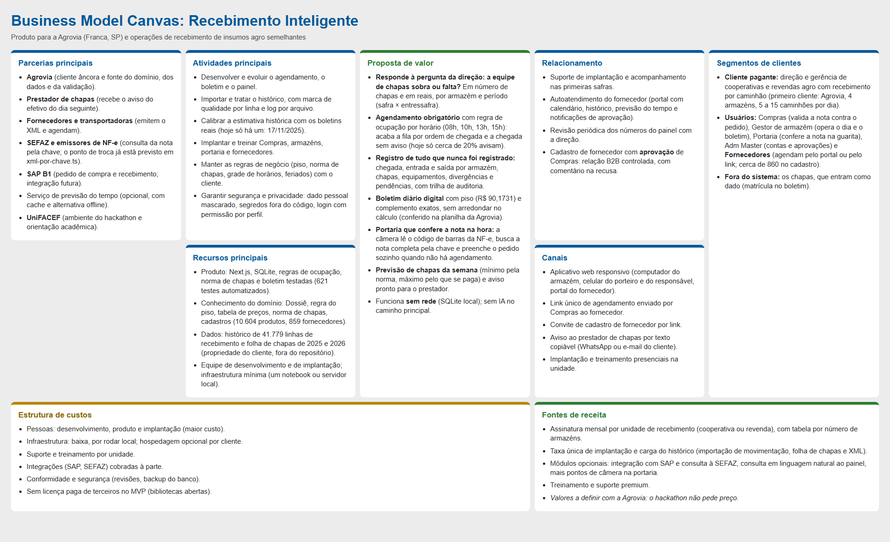

# Business Model Canvas: Recebimento Inteligente

Modelo de negócio do produto para a **Agrovia** (cooperativa de Franca, SP, fundada em 1985, cerca de 2.200 cooperados) e para quem opera um recebimento de insumos parecido. Os números de dor vêm do Dossiê e das respostas da Agrovia (`docs/00-problema.md`); os de resultado, de `docs/relatorio.md`.

Versão em texto, bloco a bloco:

| Bloco | Conteúdo |
|---|---|
| **Segmentos de clientes** | **Cliente pagante:** direção e gerência de cooperativas e revendas agro com recebimento por caminhão (primeiro cliente: Agrovia, 4 armazéns, 5 a 15 caminhões por dia). **Usuários:** Compras (valida a nota contra o pedido), Gestor de armazém (opera o dia e o boletim), Portaria (confere a nota na guarita), Adm Master (contas e aprovações) e **Fornecedores** (agendam pelo portal ou pelo link; cerca de 860 no cadastro). **Fora do sistema:** os funcionários, que entram como dado (matrícula no boletim). |
| **Proposta de valor** | **Responde à pergunta da direção: a equipe de funcionários sobra ou falta?** Em número de funcionários e em reais, por armazém e período (safra × entressafra). **Agendamento obrigatório** com regra de ocupação por horário (08h, 10h, 13h, 15h): acaba a fila por ordem de chegada e a chegada sem aviso (hoje só cerca de 20% avisam). **Registro de tudo que nunca foi registrado:** chegada, entrada e saída por armazém, funcionários, equipamentos, divergências e pendências, com trilha de auditoria. **Boletim diário digital** com piso (R$ 90,1731) e complemento exatos, sem arredondar no cálculo (conferido na planilha da Agrovia). **Portaria que confere a nota na hora:** a câmera lê o código de barras da NF-e, busca a nota completa pela chave e preenche o pedido sozinho quando não há agendamento. **Previsão de funcionários da semana** (mínimo pela norma, máximo pelo que se paga) e aviso pronto para o prestador. Funciona **sem rede** (SQLite local); sem IA no caminho principal. |
| **Canais** | Aplicativo web responsivo (computador do armazém, celular do porteiro e do responsável, portal do fornecedor). Link único de agendamento enviado por Compras ao fornecedor. Convite de cadastro de fornecedor por link. Aviso ao prestador de funcionários por texto copiável (WhatsApp ou e-mail do cliente). Implantação e treinamento presenciais na unidade. |
| **Relacionamento** | Suporte de implantação e acompanhamento nas primeiras safras. Autoatendimento do fornecedor (portal com calendário, histórico, previsão do tempo e notificações de aprovação). Revisão periódica dos números do painel com a direção. Cadastro de fornecedor com **aprovação** de Compras: relação B2B controlada, com comentário na recusa. |
| **Fontes de receita** | Assinatura mensal por unidade de recebimento (cooperativa ou revenda), com tabela por número de armazéns. Taxa única de implantação e carga do histórico (importação de movimentação, folha de funcionários e XML). Módulos opcionais: integração com SAP e consulta à SEFAZ, consulta em linguagem natural ao painel, mais pontos de câmera na portaria. Treinamento e suporte premium. *Valores a definir com a Agrovia: o hackathon não pede preço.* |
| **Recursos principais** | Produto: Next.js, SQLite, regras de ocupação, norma de funcionários e boletim testadas (621 testes automatizados). Conhecimento do domínio: Dossiê, regra do piso, tabela de preços, norma de funcionários, cadastros (10.604 produtos, 859 fornecedores). Dados: histórico de 41.779 linhas de recebimento e folha de funcionários de 2025 e 2026 (propriedade do cliente, fora do repositório). Equipe de desenvolvimento e de implantação; infraestrutura mínima (um notebook ou servidor local). |
| **Atividades principais** | Desenvolver e evoluir o agendamento, o boletim e o painel. Importar e tratar o histórico, com marca de qualidade por linha e log por arquivo. Calibrar a estimativa histórica com os boletins reais (hoje só há um: 17/11/2025). Implantar e treinar Compras, armazéns, portaria e fornecedores. Manter as regras de negócio (piso, norma de funcionários, grade de horários, feriados) com o cliente. Garantir segurança e privacidade: dado pessoal mascarado, segredos fora do código, login com permissão por perfil. |
| **Parcerias principais** | **Agrovia** (cliente âncora e fonte do domínio, dos dados e da validação). **Prestador de funcionários** (recebe o aviso do efetivo do dia seguinte). **Fornecedores e transportadoras** (emitem o XML e agendam). **SEFAZ e emissores de NF-e** (consulta da nota pela chave; o ponto de troca já está previsto em `xml-por-chave.ts`). **SAP B1** (pedido de compra e recebimento; integração futura). Serviço de previsão do tempo (opcional, com cache e alternativa offline). **UniFACEF** (ambiente do hackathon e orientação acadêmica). |
| **Estrutura de custos** | Pessoas: desenvolvimento, produto e implantação (maior custo). Infraestrutura: baixa, por rodar local; hospedagem opcional por cliente. Suporte e treinamento por unidade. Integrações (SAP, SEFAZ) cobradas à parte. Conformidade e segurança (revisões, backup do banco). Sem licença paga de terceiros no MVP (bibliotecas abertas). |

## Métricas de sucesso do negócio

| Métrica | Hoje | Meta com o sistema |
|---|---|---|
| Fornecedores que avisam a entrega | cerca de 20% | 100% (agendamento obrigatório) |
| Descargas com chegada, início e fim registrados | 0% | 100% |
| Boletins consolidados | 0 (papel) | 1 por armazém por dia |
| Visibilidade de sobra ou falta de funcionários | nenhuma | por dia, armazém e período, em funcionários e em R$ |
| Caminhão sem vaga | sem informação | recebe a próxima data disponível na hora |

## Ligação com o produto

Cada bloco tem tela ou regra correspondente: proposta de valor ↔ [casos de uso](casos-de-uso.md); atividades ↔ [processo BPMN](processo-bpmn.md); recursos de dados ↔ [DER](der.md); critérios de aceite ↔ [matriz de rastreabilidade](rastreabilidade.md); ciclo de vida do pedido ↔ [estados](estados.md).
