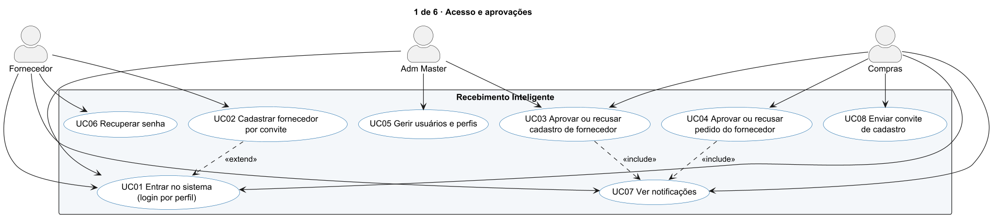
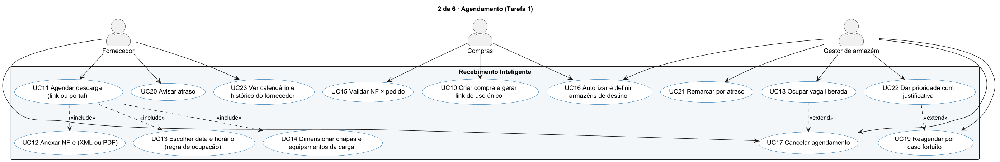
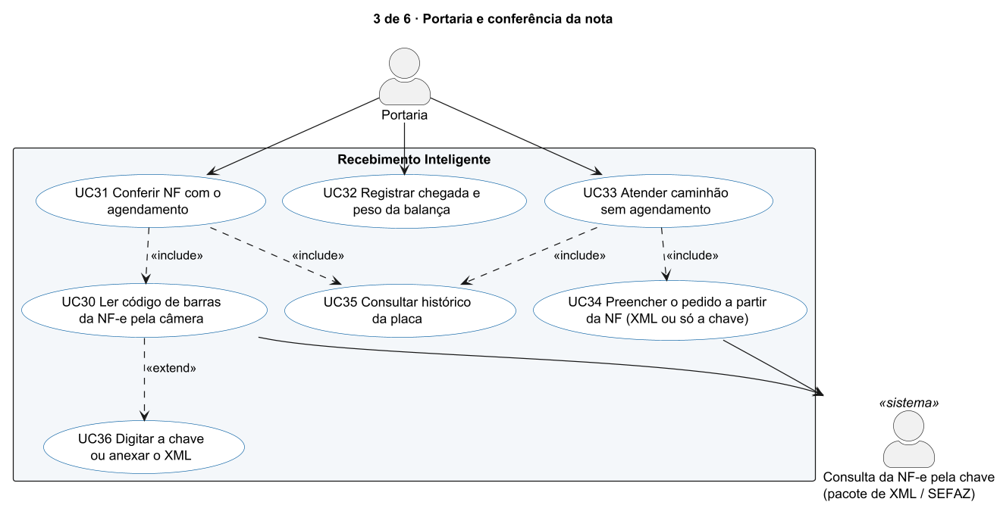
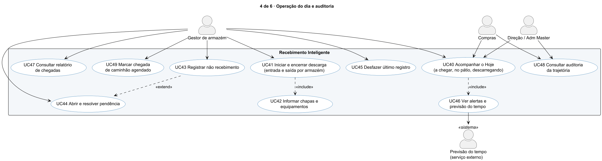
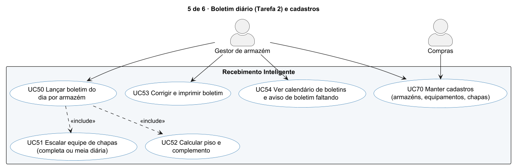
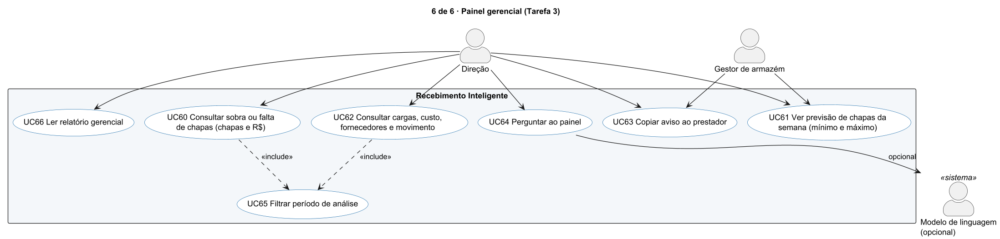

# Casos de uso (UML)

Fonte do diagrama: [`casos-de-uso.puml`](casos-de-uso.puml) (PlantUML, 6 diagramas, um por módulo). Imagens em `img/cu-*.png`.

**Atores humanos** (perfis de login, D49 e D53): **Fornecedor**, **Compras**, **Portaria**, **Gestor de armazém**, **Adm Master** e **Direção** (a direção usa o perfil Adm Master; no diagrama aparece separada porque faz a pergunta central). **Atores sistema:** consulta da NF-e pela chave (hoje o pacote de XML, amanhã SEFAZ), previsão do tempo e modelo de linguagem (opcional). Os **funcionários não usam o sistema**: entram como dado (matrícula no boletim).

**Perfis no sistema:** os papéis Gestor de armazém e Direção dos diagramas são exercidos pelos perfis **Compras** e **Adm Master** (D49); o perfil Armazém acessa só Hoje, registro de descarga e conferência de nota (D53). A tabela de acesso está em [DOCUMENTACAO.md](../DOCUMENTACAO.md#2-perfis-e-acesso).

Relações: seta cheia = o ator participa; `<<include>>` = o caso sempre usa o outro; `<<extend>>` = o caso acrescenta comportamento em certas condições.

## 1. Acesso e aprovações

## 2. Agendamento (Tarefa 1)

## 3. Portaria e conferência da nota

## 4. Operação do dia e auditoria

## 5. Boletim diário (Tarefa 2) e cadastros

## 6. Painel gerencial (Tarefa 3)

## Descrição dos casos de uso

| Código | Caso de uso | Ator | Pré-condição | Resultado | Requisito / decisão |
|---|---|---|---|---|---|
| UC01 | Entrar no sistema | todos | conta ativa | sessão com cookie assinado; cada perfil vê só suas telas | D49, D53 |
| UC02 | Cadastrar fornecedor por convite | Fornecedor | link de convite válido | cadastro `pendente` até Compras decidir | D49 |
| UC03 | Aprovar ou recusar cadastro | Compras, Adm Master | cadastro pendente | `aprovado` libera o portal; recusa exige comentário; fica em `log_aprovacao` | D49 |
| UC04 | Aprovar ou recusar pedido do fornecedor | Compras | pedido `aguardando` (vaga já reservada) | `aprovado` confirma; `recusado` libera a vaga; o card mostra a NF-e e abre para análise | D49 |
| UC05 | Gerir usuários e perfis | Adm Master | perfil Adm Master | cria conta de Compras, ativa e desativa, reseta senha | D49 |
| UC06 | Recuperar senha | Fornecedor | e-mail cadastrado | link na tela (sem servidor de e-mail) | D49 |
| UC07 | Ver notificações | Fornecedor, Compras | decisão tomada | aviso de aprovação ou recusa | D49 |
| UC08 | Enviar convite de cadastro | Compras | — | link de uso único | D49 |
| UC10 | Criar compra e gerar link | Compras | fornecedor cadastrado | link com token de uso único; link preenchido confirma a compra | RF1-17 |
| UC11 | Agendar descarga | Fornecedor | link válido ou portal | agendamento gravado; pelo portal nasce `aguardando` | RF1-01 a 04 |
| UC12 | Anexar NF-e | Fornecedor | XML ou PDF com chave de 44 dígitos | chave, emitente, itens, pesos, volumes, espécie e placa lidos; arquivo guardado e baixável | RF1-01, 18; D38 |
| UC13 | Escolher data e horário | Fornecedor | dia útil | só 08h, 10h, 13h e 15h; horário cheio é recusado e mostra a próxima data | RF1-03, 04; D23, D43 |
| UC14 | Dimensionar funcionários e equipamentos | Sistema | NF anexada | mínimo de funcionários e empilhadeira pela norma por carga | D25, D26 |
| UC15 | Validar NF × pedido | Compras | agendamento criado | conforme, divergente ou aguardando pedido, com alertas de CNPJ, quantidade e peso | RF1-05; D24 |
| UC16 | Autorizar e definir armazéns | Compras, Gestor | NF validada | armazéns de destino (sugestão pelo grupo do produto) | RF1-06, 07; D16 |
| UC17 | Cancelar agendamento | Fornecedor, Gestor | agendado | vaga liberada | RF1-14, 19 |
| UC18 | Ocupar vaga liberada | Gestor | vaga liberada | outro agendado ocupa; evento `vaga_ocupada` | RF1-15 |
| UC19 | Reagendar por caso fortuito | Gestor | agendado | nova data com exceção do limite do horário | RF1-13 |
| UC20 | Avisar atraso | Fornecedor, Portaria | agendado | evento `atraso` com previsão e motivo | grupo 6 |
| UC21 | Remarcar por atraso | Gestor | mais de 30 min | próximo horário livre e aviso ao fornecedor | RF1-20; D27 |
| UC22 | Dar prioridade com justificativa | Gestor | defensivo ou fertilizante | exceção de ocupação gravada com a justificativa | D23 |
| UC23 | Ver calendário e histórico | Fornecedor | portal | pedidos por dia, com previsão do tempo | D52 |
| UC30 | Ler código de barras pela câmera | Portaria | permissão da câmera | chave de 44 dígitos (quadros, recorte e ampliação; foto como alternativa) | D53; Portaria |
| UC31 | Conferir NF com o agendamento | Portaria | chave ou XML | veredito: confere, confere com aviso, divergente, sem agendamento ou escolher | D53 |
| UC32 | Registrar chegada e peso | Portaria | agendamento aprovado | chegada única; peso da balança acima de 500 kg | RF1-08, 26 |
| UC33 | Atender caminhão sem agendamento | Portaria | — | com vaga, agenda na hora; sem vaga, não recebimento e próxima data | RF1-21 |
| UC34 | Preencher o pedido a partir da NF | Portaria | XML ou só a chave | pedido nasce com fornecedor, NF, itens, peso, placa e observação | Portaria |
| UC35 | Consultar histórico da placa | Portaria | placa | descargas anteriores do caminhão | grupo 4 |
| UC36 | Digitar a chave ou anexar o XML | Portaria | câmera indisponível | mesma conferência | D53 |
| UC40 | Acompanhar o Hoje | Gestor, Compras, Direção | — | cards de entrega com etapas, cronômetro e previsão de término; atualiza sozinho | RF1-24b; D51, D52 |
| UC41 | Iniciar e encerrar descarga | Gestor | caminhão chegou | entrada e saída por armazém; liberado na última saída | RF1-08 a 10, 22, 24a |
| UC42 | Informar funcionários e equipamentos | Gestor | descarga encerrada | funcionários e equipamentos por armazém | RF1-11, 12 |
| UC43 | Registrar não recebimento | Gestor | — | 1 dos 4 motivos; "outro" exige descrição | RF1-16 |
| UC44 | Abrir e resolver pendência | Gestor | divergência | carga recebida com pendência listada e resolvida depois | RF1-23; D24 |
| UC45 | Desfazer último registro | Gestor | registro recente | evento `desfeito` e estado anterior restaurado | D51 |
| UC46 | Ver alertas e previsão do tempo | Gestor | — | falta de funcionários, equipamento ou espaço; tempo com alternativa offline | grupos 2 e 6 |
| UC47 | Consultar relatório de chegadas | Gestor | — | chegadas por período | grupo 6 |
| UC48 | Consultar auditoria | Compras, Adm Master | — | trajetória do pedido a partir dos eventos e do `log_aprovacao` | Auditoria |
| UC49 | Marcar chegada | Gestor | agendado | status `chegou` | RF1-08 |
| UC50 | Lançar boletim | Gestor | armazém que faz boletim | produção por linha, equipe e resultado exato | RF2-01 a 09 |
| UC51 | Escalar equipe | Gestor | boletim aberto | de 1 a 20 funcionários por matrícula, diária completa ou meia | RF2-03 |
| UC52 | Calcular piso e complemento | Sistema | produção e equipe | valor por diária, total a pagar e complemento (piso R$ 90,1731) | RF2-04, 05, 07; D10 |
| UC53 | Corrigir e imprimir | Gestor | boletim lançado | recálculo ao salvar; versão para impressão | RF2-10 |
| UC54 | Ver calendário de boletins | Gestor | — | dias completos, pagos sem produção e faltando (faixa passando com X) | D52 |
| UC60 | Consultar sobra ou falta | Direção | período | frase, funcionários e R$ por armazém, com método e origem | RF3-00; D29 |
| UC61 | Ver previsão de funcionários da semana | Direção, Gestor | agenda da semana | mínimo (norma) e máximo (produção ÷ piso) por dia | D50, D52 |
| UC62 | Consultar cargas, custo, fornecedores, movimento | Direção | — | indicadores do histórico e dos dados novos, sempre com a origem | RF3-01, 06, 07, 09 |
| UC63 | Copiar aviso ao prestador | Direção, Gestor | previsão do dia seguinte | texto pronto para copiar | grupo 2 |
| UC64 | Perguntar ao painel | Direção | — | consulta fixa escolhida por palavras (a LLM, se houver chave, só escolhe a consulta) | grupo 3; D32 |
| UC65 | Filtrar período de análise | Direção | — | gráficos gerados na hora para o período | D52 |
| UC66 | Ler relatório gerencial | Direção | — | `docs/relatorio.md` com os mesmos números | ART-4 |
| UC70 | Manter cadastros | Gestor, Compras | — | armazéns, equipamentos, funcionários, grade e parâmetros | RF1-25; D47 |

## Matriz ator × caso de uso (resumo)

| Ator | Casos de uso |
|---|---|
| Fornecedor | UC01, 02, 06, 07, 11 a 13, 17, 20, 23 |
| Compras | UC01, 03, 04, 07, 08, 10, 15, 16, 40, 48, 70 |
| Portaria | UC30 a 36, 20 |
| Gestor de armazém | UC16 a 19, 21, 22, 40 a 47, 49 a 54, 61, 63, 70 |
| Adm Master | UC01, 03, 05, 48 e tudo que Compras e Direção fazem |
| Direção | UC40, 48, 60 a 66 |

Rastreabilidade completa até as telas, as rotas e os testes: [rastreabilidade.md](rastreabilidade.md).
