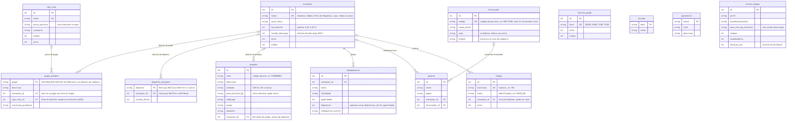
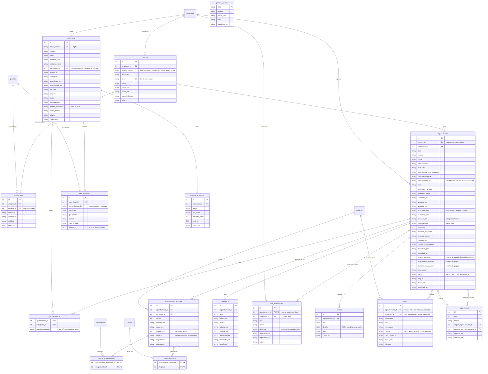
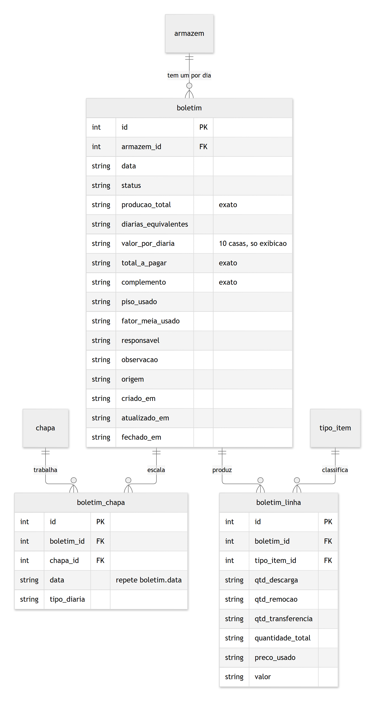
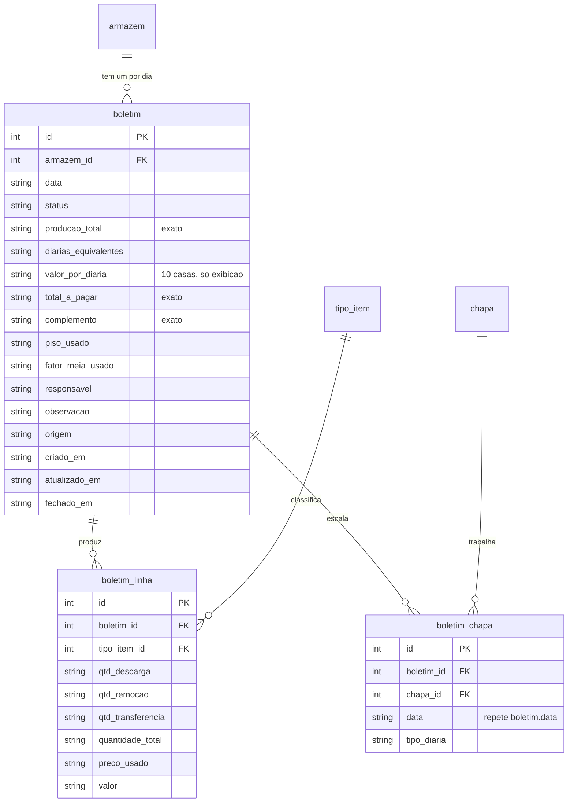
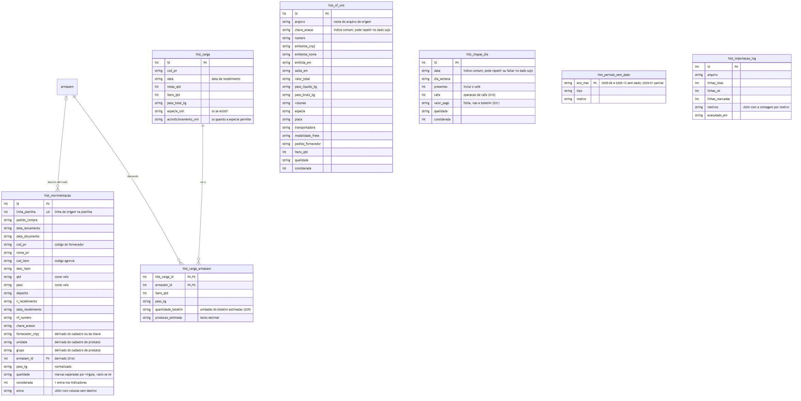
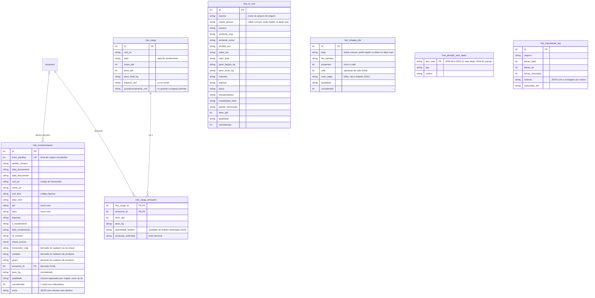
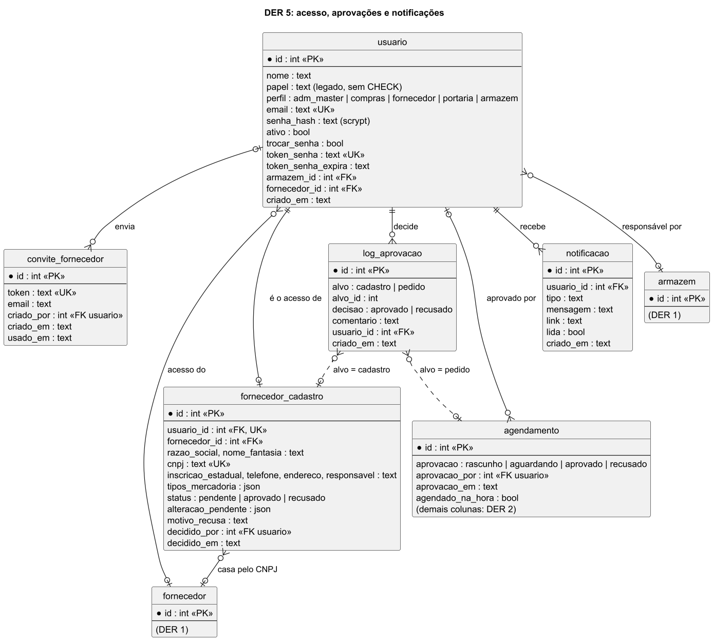

# DER: modelo de dados

**Contrato congelado.** As janelas de código leem este modelo e o schema do Drizzle gerado dele (`web/lib/db/schema.ts`). Ninguém altera tabela ou coluna na fase paralela: a necessidade vai para `docs/pedidos/janela-X.md` e a janela geral aplica na integração (migração só lá).
Única exceção antes do congelamento: no passo 0, ao abrir os arquivos reais, a janela geral pode **acrescentar** coluna (nunca renomear nem remover) e registra aqui.
Decisões que sustentam o modelo: `docs/DECISOES.md` (D02, D03, D06, D10 a D31, D35, D37 a D39, D42, D43). Revisado pelo architect do ECC em 03/10 (o que mudou está na seção 7 de DECISOES). **Congelado a partir daqui.**

## Convenções

- Chave primária `id` INTEGER autoincrementada, salvo onde está marcado outro tipo.
- **Dinheiro, peso e quantidade com casas decimais: TEXT com número decimal** (`"0.3224"`), lido sempre com `decimal.js`. Nunca `number`.
- Data `YYYY-MM-DD`; horário de grade `HH:MM`; instante ISO 8601 com deslocamento (`2026-10-05T08:12:00-03:00`). Tudo TEXT. A hora atual vem de `lib/relogio.ts` (D37).
- Os instantes são sempre gravados pelo código, com `-03:00` (só assim o texto ordena e compara certo). Proibido `DEFAULT CURRENT_TIMESTAMP` no schema e `date('now')` ou `datetime('now')` em consulta: são UTC, têm outro formato e ignoram o relógio da demo.
- **Valor dentro do SQL:** nunca `SUM`, `MAX`, `ORDER BY` ou `>` sobre coluna de valor, peso ou quantidade (o `SUM` devolve ponto flutuante e a comparação é de texto: `"100.5" < "20"`). Some e compare no código, com `lib/money.ts`. `CAST(x AS REAL)` só para ordenar ou filtrar faixa, nunca para o número exibido.
- **Forma do texto decimal:** a que `lib/money.ts` escreve (ponto, sem expoente, sem zero à direita). Dois valores se comparam com a função de igualdade de `lib/money.ts`, não texto contra texto (`54.8080` e `54.808` são o mesmo valor).
- Booleano: INTEGER 0 ou 1.
- Enumerações: TEXT com `CHECK` nos valores listados abaixo, salvo as marcadas "sem CHECK" (texto validado só pelo zod de `lib/db/enums.ts`, para crescer sem recriar tabela): `evento.tipo`, `aviso.tipo`, `aviso.destinatario`, `usuario.papel`, `nota_fiscal.forma_entrada`, `agendamento.excecao_ocupacao`, `grupo_produto.conversao_producao` e as colunas `qualidade` e `motivos`. No Drizzle, `text({ enum })` só tipa: cada `CHECK` é um `check()` explícito, conferido no SQL da migração.
- `origem` ∈ `historico`, `teste`, `operacao` (D06). Seed e modo demo = `teste`; durante o evento o padrão também é `teste` (`lib/origem.ts`).
- Nomes de tabela e coluna em snake_case, sem acento.
- Chaves estrangeiras com `ON DELETE RESTRICT`. Nada se apaga: cancelamento é mudança de status.
- **Nulabilidade.** São `NOT NULL`: as chaves primárias; as chaves estrangeiras desenhadas como obrigatórias (`||`); as enumerações com valor inicial (`status`, `validacao_status`, `acondicionamento_ocupacao`, `acondicionamento`, `forma_entrada`, `categoria`, `tipo_diaria`, `tipo`, `papel`, `destinatario`, `perfil`); os booleanos e contadores (com padrão 0 ou 1); `origem`; os instantes de criação; e as chaves de negócio: `agendamento.data` e `horario`, `boletim.data`, `boletim_chapa.data`, `nota_fiscal.chave_acesso`, `compra.token`, `chapa.matricula` e `nome`, `armazem.nome`, `tipo_item.nome` e `preco_unitario`, `horario_grade.hora`, `feriado.data`, `parametro.valor`, `produto.item` e `produto.deposito` (texto vazio quando faltar, porque NULL não entra em índice único), `fornecedor.razao_social`, `hist_movimentacao.linha_planilha`, e as quantidades e valores de `boletim` e `boletim_linha`. **Todo o resto aceita nulo.** Em especial: `fornecedor.codigo` (fornecedor novo não tem código do parceiro; o único continua valendo, porque NULL pode repetir), tudo em `nota_fiscal` além de `chave_acesso`, `forma_entrada`, `origem` e `criada_em` (PDF com dados mínimos), e todas as colunas de `hist_*` que vêm dos arquivos (linha suja fica na tabela, marcada, D42).

## Enumerações

| Coluna | Valores |
|---|---|
| `agendamento.status` | `agendado`, `chegou`, `em_descarga`, `concluido`, `cancelado`, `nao_recebido` |
| `agendamento.acondicionamento_ocupacao` | `batido`, `unitizado` (paletizado ou big bag) |
| `agendamento.validacao_status` | `aguardando`, `conforme`, `divergente` |
| `agendamento.excecao_ocupacao` (sem CHECK) | nulo, `caso_fortuito`, `prioridade` |
| `agendamento_nf.acondicionamento` | `batido`, `paletizado`, `big_bag` |
| `nota_fiscal.forma_entrada` (sem CHECK) | `xml`, `manual` (PDF com dados digitados) |
| `compra.status` | `criada`, `confirmada`, `cancelada` |
| `pendencia.tipo` | `divergencia_nf_pedido`, `outra` |
| `pendencia.status` | `aberta`, `resolvida` |
| `nao_recebimento.motivo` | `divergencia_nota_pedido`, `sem_agendamento_sem_vaga`, `caso_fortuito`, `outro` |
| `aviso.destinatario` (sem CHECK) | `fornecedor`, `responsavel`, `compras`, `portaria`, `prestador` |
| `usuario.papel` (sem CHECK, legado do seletor) | `fornecedor`, `compras`, `portaria`, `responsavel`, `direcao` |
| `usuario.perfil` (sem CHECK, D49 e D53) | `adm_master`, `compras`, `fornecedor`, `portaria`, `armazem` |
| `fornecedor_cadastro.status` | `pendente`, `aprovado`, `recusado` |
| `agendamento.aprovacao` (sem CHECK) | `rascunho`, `aguardando`, `aprovado`, `recusado` |
| `log_aprovacao.alvo` / `.decisao` | `cadastro`, `pedido` / `aprovado`, `recusado` |
| `tipo_item.categoria` | `item` (14 tipos), `diaria` (linhas "Diária completa" e "Meia diária") |
| `boletim_chapa.tipo_diaria` | `completa`, `meia` |
| `boletim.status` | `rascunho`, `fechado` |
| `grupo_produto.conversao_producao` (sem CHECK; a calibração da janela A pode pedir outro valor, D29) | `saca_50kg` (peso ÷ 50 kg), `unidade` |
| `norma_chapas.acondicionamento` | `batido`, `paletizado`, `big_bag`, `maquina` |
| `norma_chapas.perfil` | `agrovia`, `dossie` |
| `hist_periodo_sem_dado.tipo` | `sem_dado`, `parcial` |
| `evento.tipo` (sem CHECK; valores iniciais, ver também o diagrama 5) | `agendado`, `validado`, `autorizado`, `destino_definido`, `chegou`, `entrada`, `saida`, `concluido`, `cancelado`, `remarcado`, `atraso`, `nao_recebido`, `pendencia_aberta`, `pendencia_resolvida`, `vaga_ocupada` |

## Restrições e índices que o schema precisa ter

- `agendamento_armazem`: único (`agendamento_id`, `armazem_id`).
- `boletim`: único (`armazem_id`, `data`).
- `boletim_chapa`: único (`chapa_id`, `data`), as duas `NOT NULL`: cada funcionário em um só boletim por dia; `data` repete a do boletim.
- `boletim_linha`: único (`boletim_id`, `tipo_item_id`).
- Únicos: `compra.token`, `nota_fiscal.chave_acesso`, `fornecedor.codigo` (nulo pode repetir), `chapa.matricula`, `armazem.nome`, `tipo_item.nome`, `horario_grade.hora`, `hist_movimentacao.linha_planilha`, `nao_recebimento.agendamento_id` (nulo pode repetir: um agendamento termina em no máximo um não recebimento).
- `fornecedor.cnpj`: índice comum, **não** único (dado sujo pode repetir ou faltar).
- `produto`: único (`item`, `deposito`), as duas `NOT NULL`: o mesmo item pode estar em mais de um depósito. **Quem cruza com `produto` usa o par (item, depósito)**; só pelo item, as linhas se multiplicam e o peso dobra.
- `hist_movimentacao`: índices em (`data_recebimento`), (`chave_acesso`), (`cod_item`), (`cod_pn`, `data_recebimento`).
- `hist_chapas_dia`: índice comum em (`data`). `hist_nf_xml`: índice comum em (`chave_acesso`). Não são únicos: data ou chave repetida no dado sujo fica na tabela, marcada (D42).
- `agendamento`: índices em (`data`, `horario`) e (`status`).
- **Regras que ficam no código, na mesma transação da gravação (D43):** ocupação do horário; uma NF só pode estar em um agendamento que não esteja cancelado; a vaga liberada só é ocupada se ainda estiver livre; 1 a 20 funcionários por boletim; armazém com `faz_boletim = 1`.
- **Colunas derivadas, gravadas por uma única função cada:** `agendamento.acondicionamento_ocupacao` (junto com as NF), `agendamento.liberacao_em` (junto com a última saída), `boletim_chapa.data` (junto com o boletim, ver notas). `produto.armazem_id` e as derivadas de `hist_*` copiam o mapa de `grupo_produto`: se o mapa mudar, o `db:rebuild` as recalcula.

## Quem grava em cada tabela

Todos leem tudo. Só o dono grava (além do seed e da integração).

| Tabelas | Quem grava |
|---|---|
| `compra`, `compra_item`, `agendamento`, `agendamento_nf`, `nota_fiscal`, `nota_fiscal_item`, `nota_fiscal_arquivo`, `agendamento_armazem`, `descarga_equipamento`, `descarga_chapa`, `pendencia`, `nao_recebimento`, `vaga_liberada`, `evento`, `aviso`; `fornecedor` (só para incluir fornecedor novo) | Janela C (módulo `agendamento`) |
| `boletim`, `boletim_linha`, `boletim_chapa` | Janela B (módulo `boletim`) |
| `armazem`, `equipamento`, `chapa` | Janela B (módulo `cadastros`) |
| `previsao_tempo` (só se o grupo 6 for liberado) | Janela B (módulo `dia`); a janela C apenas lê |
| `hist_*` | Janela A (importador do módulo `painel`) |
| `produto`, `grupo_produto`, `deposito_armazem`, `tipo_item`, `norma_chapas`, `usuario`, `horario_grade`, `feriado`, `parametro` | Só seed e importação do passo 0 (janela geral); as telas apenas consultam |

## Diagrama 1: cadastros e configuração

```mermaid
erDiagram
    armazem |o--o{ grupo_produto : "destino do grupo"
    armazem |o--o{ deposito_armazem : "destino do deposito"
    armazem |o--o{ produto : "destino do produto"
    armazem ||--o{ equipamento : "possui"
    armazem |o--o{ usuario : "responsavel por"
    armazem |o--o{ chapa : "lotacao"
    tipo_item |o--o{ grupo_produto : "preco do grupo"
    fornecedor |o--o{ usuario : "acesso do fornecedor"

    armazem {
        int id PK
        string nome UK "Insumos, Adubo, Patio de Maquinas, Loja, Todas as areas"
        string local_fisico
        int faz_boletim "padrao 3 de 4 (D17)"
        int recebe_descarga "destino de descarga (D47)"
        int ativo
        int ordem
    }
    grupo_produto {
        string grupo PK "FER MAQ AGR SEM PEC ALI MED ACE e os demais do cadastro"
        string descricao
        int armazem_id FK "nulo se o grupo nao esta no mapa"
        int tipo_item_id FK "linha do boletim usada na estimativa (D29)"
        string conversao_producao
    }
    deposito_armazem {
        string deposito PK "MATLoja MATGeral MATFerti e outros"
        int armazem_id FK "nulo para MATProv e MATReser"
        int recebe_direto
    }
    produto {
        int id PK
        string item "codigo Agrovia, ex FER000003"
        string descricao
        string unidade "TON SC UN e outras"
        string peso_unitario_kg "texto decimal, pode faltar"
        string subgrupo
        string grupo
        string deposito
        int armazem_id FK "derivado do grupo, senao do deposito"
    }
    fornecedor {
        int id PK
        string codigo UK "codigo do parceiro, ex FD017530; nulo no fornecedor novo"
        string razao_social
        string cnpj "so digitos; indice nao unico"
        string origem "historico se veio do cadastro"
    }
    equipamento {
        int id PK
        int armazem_id FK
        string nome
        string finalidade
        int quantidade
        int disponivel "quantos estao disponiveis, de 0 a quantidade"
        string indisponivel_motivo
    }
    chapa {
        int id PK
        string matricula UK "numero, ex 158"
        string nome "identificador, ex CHAPA_08"
        int armazem_id FK "lotacao habitual, pode ser nulo"
        int ativo
    }
    tipo_item {
        int id PK
        string nome UK
        string preco_unitario "texto decimal 4 casas"
        string categoria
        int ordem
        int ativo
    }
    horario_grade {
        int id PK
        string hora UK "08:00 10:00 13:00 15:00"
        int ativo
        int ordem
    }
    feriado {
        string data PK
        string nome
    }
    parametro {
        string chave PK
        string valor
        string descricao
    }
    usuario {
        int id PK
        string nome
        string papel
        int armazem_id FK
        int fornecedor_id FK
    }
    norma_chapas {
        int id PK
        string perfil
        string acondicionamento
        string peso_min_kg_exclusivo "vale acima deste peso"
        int chapas
        int empilhadeira
        int duracao_min "estimativa do dossie"
    }
```

Chaves de `parametro` no seed: `piso_diaria` (90.1731), `fator_meia` (0.5), `max_chapas_boletim` (20), `tolerancia_min` (30), `limite_peso_chapa_kg` (500), `capacidade_unitizado` (2), `jornada_h` (8), `safra_meses` (10,11,12,1,2,3), `perfil_norma` (agrovia), `dias_minimos_mes` (10).

## Diagrama 2: agendamento (Tarefa 1)

## Diagrama 3: boletim (Tarefa 2)

## Diagrama 4: histórico e painel (Tarefa 3)

## Diagrama 5: acesso, aprovações e notificações (D49, D53; acrescentado depois do congelamento)

Tabelas e colunas que entraram por decisão do humano depois da primeira versão do modelo, todas por **migração aditiva** (nada renomeado nem removido). Fonte da verdade: `web/lib/db/schema.ts`.

Fonte do diagrama: `docs/artefatos/der-5.puml`.

| Tabela | Para que serve |
|---|---|
| `usuario` (colunas novas) | Login por e-mail e senha (scrypt), `perfil` (adm_master, compras, fornecedor, portaria, armazem), `ativo`, troca obrigatória de senha e token de recuperação de uso único. O `papel` antigo do seletor continua para compatibilidade |
| `convite_fornecedor` | Link de uso único que Compras envia; leva ao formulário de cadastro |
| `fornecedor_cadastro` | Cadastro B2B do fornecedor: `pendente`, `aprovado` ou `recusado`; a alteração de dados fica em `alteracao_pendente` até Compras aprovar; casa com `fornecedor` pelo CNPJ |
| `notificacao` | Aviso ao usuário (cadastro e pedido aprovado ou recusado) |
| `log_aprovacao` | Só inclusão: quem aprovou ou recusou cada cadastro e cada pedido, com comentário. Alimenta a tela Auditoria |
| `agendamento` (colunas novas) | `aprovacao` (rascunho, aguardando, aprovado, recusado), `aprovacao_por`, `aprovacao_em`; pedido do portal nasce `aguardando` e reserva a vaga; link de Compras e portaria nascem `aprovado` |

**Eventos (`evento.tipo`, sem CHECK):** acrescentado `desfeito` (desfazer o último registro de descarga). Valores atuais: agendado, validado, autorizado, destino_definido, chegou, entrada, saida, concluido, desfeito, cancelado, remarcado, atraso, nao_recebido, pendencia_aberta, pendencia_resolvida, vaga_ocupada.

**Perfis (`usuario.perfil`):** adm_master (tudo, mais contas), compras, fornecedor (só o portal), portaria (só "Conferir nota fiscal") e armazem (Hoje, descarga, boletim, cadastros). Permissão por caminho no `proxy.ts` e conferência no banco em `lib/auth.ts`.

**Pedido sem agendamento (portaria):** não tem tabela própria. `caminhaoSemAgendamento` cria um `agendamento` com `agendado_na_hora = 1`, `status = chegou`, `compra_id` nulo e, quando a nota foi lida, grava `nota_fiscal`, `nota_fiscal_item`, `nota_fiscal_arquivo` e `agendamento_nf`, além de `peso_declarado_kg` e a observação com o número da NF. A busca da nota pela chave (`xml-por-chave.ts`) lê o pacote de XML; em produção é o ponto de troca para a SEFAZ.

## Notas por assunto

- **Mais de uma NF por agendamento:** `agendamento_nf` (N:N) com o acondicionamento por NF. Um caminhão = um `agendamento` e uma `chegada_em`.
- **Entrada e saída por armazém:** `agendamento_armazem` tem `entrada_em` e `saida_em` próprios; `agendamento.liberacao_em` recebe a última saída (P13). O número de funcionários é por armazém e **não soma no dia** (o efetivo do dia vem do boletim).
- **Link da compra:** o token vale uma vez (RF1-17). Enquanto a compra está `criada`, o link agenda; confirmado o agendamento, a compra vira `confirmada` e o mesmo link passa a mostrar o agendamento, com a opção de cancelar. Para nova data depois de um cancelamento, Compras gera outro link.
- **Remarcação** não cria agendamento novo: muda `data` e `horario`, soma em `remarcacoes` e grava `evento` com o antes e o depois. A vaga antiga fica livre porque a ocupação é calculada.
- **Pendência de divergência:** linha em `pendencia`; a carga segue até `concluido`. `nao_recebimento` é o caminho explícito (R p. 2) e não cria pendência.
- **Anexo da NF:** XML ou PDF em `nota_fiscal_arquivo.conteudo` (D38). Nunca um arquivo real da Agrovia no repositório: os testes usam fixture sintética. Toda consulta que lista anexos escolhe as colunas e deixa `conteudo` de fora; o BLOB só é lido no download.
- **Boletim:** `boletim` guarda o resultado exato e os parâmetros usados (`piso_usado`, `fator_meia_usado`) para auditoria. O cálculo mora em `lib/boletim/calculo.ts`. `boletim_chapa.data` existe só para o índice único "um funcionário, um boletim por dia": salvar o boletim regrava `boletim_linha` e `boletim_chapa` na mesma transação, sempre com a data do boletim (uma única função de salvar).
- **Reserva do dimensionamento (grupo 2):** `agendamento.chapas_previstas`, `empilhadeira_prevista` e `duracao_prevista_min` guardam a fotografia da norma no momento do agendamento, para a tela do dia e o painel lerem o mesmo número sem importar código de outro módulo. Ficam nulas no MVP.
- **Relógio:** o instante "agora" vem de `lib/relogio.ts`, que guarda a âncora do relógio da demo em arquivo ao lado do banco; reiniciar o servidor não volta o relógio (D37).
- **Painel:** lê `hist_*`, `agendamento*`, `boletim*`, `norma_chapas`, `grupo_produto`, `tipo_item` e `parametro`; não tem tabela própria além das `hist_*`. Os indicadores de tempo (RF3-02 a RF3-05, horários de RF3-07, RF3-08) só têm dado em `teste` ou `operacao`.
- **Importação do histórico (D42):** os originais ficam em `PACOTE_DIR` (fora do git). O importador da janela A (`lib/painel/importar/`) apaga e recarrega as `hist_*` numa transação, mantém toda linha com `qualidade` e `considerada`, e grava `hist_importacao_log`. `hist_carga` e `hist_carga_armazem` são derivadas no fim da importação (D21).
- **Cadastros:** `produto` e `fornecedor` são importados no passo 0; `chapa` vem da lista matrícula → nome da planilha do boletim, mais as CHAPA_nn das folhas que não estiverem nela (matrícula = o próprio identificador); `equipamento` vem da tabela do dossiê (a planilha só tem nome e utilização).
- **Reserva para os grupos 2 a 6** (sem tela no MVP): `agendamento.prioridade`, `excecao_ocupacao`, `motorista`, `extra` e as três colunas `*_prevista*`, `equipamento.disponivel` e `indisponivel_motivo`, `previsao_tempo`, `aviso.armazem_id`, `aviso.detalhe` e `aviso.destinatario = prestador`, `descarga_chapa` (em que armazém cada funcionário trabalhou, pedido da Agrovia), `norma_chapas`. Câmera e histórico do motorista usam `nota_fiscal.chave_acesso` e `agendamento.placa`, sem tabela nova.
