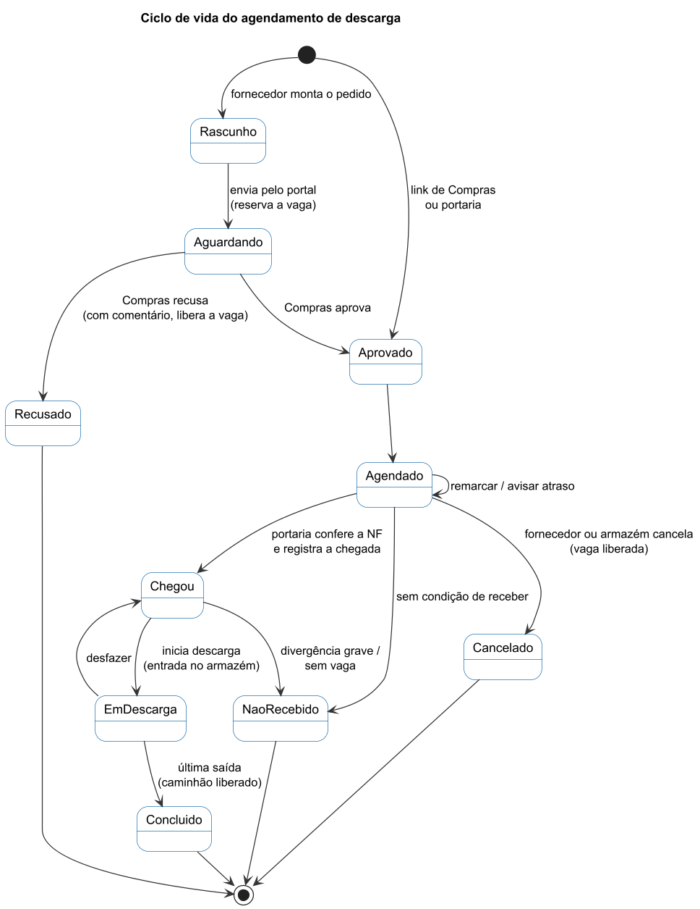

# Estados do agendamento e regras de transição

Diagrama de estados UML do agendamento de descarga. Fonte: [`estados.puml`](estados.puml).

Há duas colunas independentes no `agendamento`:

| Coluna | Valores | Quem muda |
|---|---|---|
| `aprovacao` (D49) | `rascunho`, `aguardando`, `aprovado`, `recusado` | Fornecedor envia; Compras decide |
| `status` (operação) | `agendado`, `chegou`, `em_descarga`, `concluido`, `cancelado`, `nao_recebido` | Portaria e Gestor de armazém |

Pedido do portal nasce `aguardando` e **já reserva a vaga**; recusa libera a vaga. Link de Compras e pedido criado na portaria nascem `aprovado`.

## Transições e o evento que cada uma grava

| De | Para | Quem | Evento (`evento.tipo`) | Regra |
|---|---|---|---|---|
| (novo) | agendado | Fornecedor, Compras, Portaria | `agendado` | Ocupação verificada e gravada na mesma transação (D23, D43) |
| agendado | agendado | Gestor | `remarcado`, `atraso` | Remarcar muda data e horário, soma `remarcacoes`; atraso avisado não muda estado |
| agendado | cancelado | Fornecedor, Gestor | `cancelado`, `vaga_ocupada` | A vaga liberada pode ser ocupada por outro agendado |
| agendado | chegou | Portaria, Gestor | `chegou` | Chegada única; peso da balança acima de 500 kg |
| agendado | nao_recebido | Gestor | `nao_recebido` | 1 dos 4 motivos; "outro" exige descrição |
| chegou | em_descarga | Gestor | `entrada` | Entrada por armazém; cronômetro e previsão de término |
| chegou | nao_recebido | Gestor, Portaria | `nao_recebido` | Divergência grave ou sem vaga |
| em_descarga | concluido | Gestor | `saida`, `concluido` | Liberado na última saída; funcionários e equipamentos por armazém |
| em_descarga | chegou | Gestor | `desfeito` | Desfazer o último registro |
| qualquer | (pendência) | Gestor | `pendencia_aberta`, `pendencia_resolvida` | Divergência pequena entra como pendência, a carga segue (D24) |
| qualquer | (validação) | Compras | `validado`, `autorizado`, `destino_definido` | Não mudam o `status`; marcam o caminho da auditoria |

## Regra de ocupação de horário (resumo)

| Situação do horário (08h, 10h, 13h, 15h) | Aceita |
|---|---|
| vazio | batido ou paletizado/big bag |
| 1 batido | nada mais |
| 1 ou 2 paletizados/big bag | mais um paletizado/big bag até 2; nunca batido |
| cancelado e remarcado | não contam |
| caso fortuito | ignora o limite (o excedente passa a contar) |

Capacidade do dia = 8 − nº de batidos (mínimo 4). Sem recebimento aos sábados, domingos e feriados.

## Veredito da conferência da nota na portaria

| Veredito | Quando | Ação |
|---|---|---|
| `confere` | chave, fornecedor, dia, horário, pedido e placa batem | registrar chegada |
| `confere_com_aviso` | bate, mas com diferença (ex.: dia, horário ou placa) | registrar chegada mostrando o aviso |
| `divergente` | o agendamento existe e a nota não bate | decisão do Gestor; pode virar pendência ou não recebimento |
| `escolher` | mais de um agendamento do CNPJ no dia | portaria escolhe o certo |
| `sem_agendamento` | nenhum agendamento encontrado | agenda na hora se houver vaga, **com o pedido preenchido pela nota** (XML ou só a chave) |

## Estados do cadastro de fornecedor

`pendente` → `aprovado` (libera o portal) ou `recusado` (com comentário). Alteração de dados de um cadastro aprovado fica em `alteracao_pendente` até nova aprovação; os dados atuais continuam valendo.
