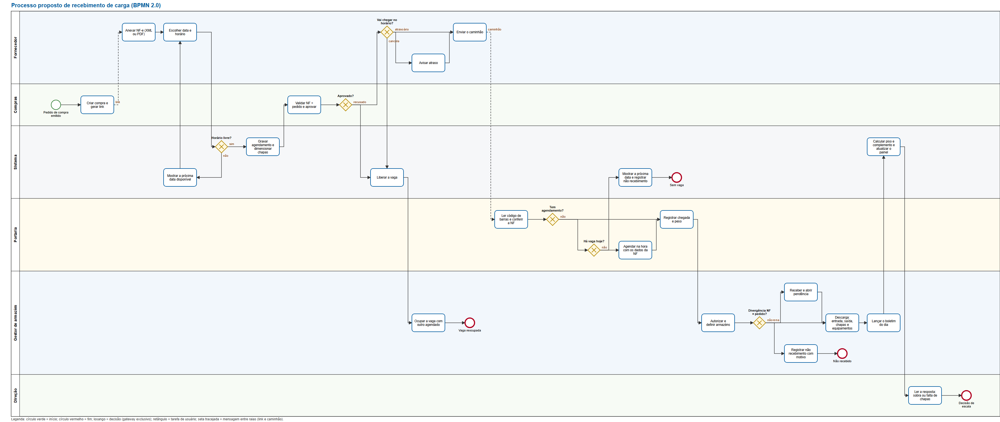

# Processo proposto de recebimento (BPMN 2.0)

É o processo **proposto**, com o sistema, não o atual. Arquivos: [`processo.bpmn`](processo.bpmn) (BPMN 2.0 com diagrama de interchange, abre no bpmn.io, Camunda Modeler e similares) e [`img/processo-bpmn.svg`](img/processo-bpmn.svg) (vetor) e `img/processo-bpmn.png`.

**Raias:** Fornecedor, Compras, Sistema, Portaria, Gestor de armazém e Direção.
**Notação:** círculo verde = início; círculo vermelho = fim; losango com X = decisão (gateway exclusivo); retângulo = tarefa de usuário; seta tracejada = mensagem entre raias (o link da compra e o caminhão que chega).

## Passo a passo

| # | Raia | Tarefa | O que o sistema faz | Regra |
|---|---|---|---|---|
| 1 | Compras | Criar compra e gerar link | Token de uso único; o fornecedor também pode agendar pelo portal | RF1-17 |
| 2 | Fornecedor | Anexar NF-e (XML ou PDF) | Lê chave, emitente, itens, pesos, volumes, espécie e placa; guarda o arquivo | RF1-01, 18; D38 |
| 3 | Fornecedor | Escolher data e horário | Só dia útil e horários 08h, 10h, 13h, 15h | RF1-03, 04 |
| 4 | Sistema | Horário livre? | Verifica a ocupação e grava na mesma transação | D23, D43 |
| 4a | Sistema | Mostrar a próxima data | Se cheio, recusa e devolve a próxima data; o fornecedor escolhe de novo | RF1-04 |
| 5 | Sistema | Gravar agendamento e dimensionar funcionários | Guarda mínimo de funcionários e empilhadeira da carga pela norma | D25, D26 |
| 6 | Compras | Validar NF × pedido e aprovar | Alertas de CNPJ, quantidade e peso; pedido do portal nasce `aguardando` e reserva a vaga | RF1-05; D49 |
| 7 | Compras | Aprovado? | Recusa exige comentário, grava `log_aprovacao` e notifica o fornecedor | D49 |
| 7a | Sistema | Liberar a vaga | Cancelamento e recusa liberam a vaga | RF1-14, 19 |
| 7b | Gestor | Ocupar a vaga com outro agendado | Evento `vaga_ocupada` | RF1-15 |
| 8 | Fornecedor | Vai chegar no horário? | Cancela, avisa atraso ou envia o caminhão | RF1-20; D27 |
| 9 | Portaria | Ler código de barras e conferir a NF | Câmera lê os 44 dígitos, busca a nota pela chave e compara com o registro | D53 |
| 10 | Portaria | Tem agendamento? | Procura pela chave e, sem ela, pelo CNPJ do emitente | D53 |
| 11 | Portaria | Há vaga hoje? | Com vaga, agenda na hora e já preenche fornecedor, NF, itens, peso e placa com os dados da nota | RF1-21 |
| 11a | Sistema | Próxima data e não recebimento | Sem vaga, registra `sem_agendamento_sem_vaga` e mostra a próxima data | RF1-16 |
| 12 | Portaria | Registrar chegada e peso | Chegada única; balança acima de 500 kg | RF1-08, 26 |
| 13 | Gestor | Autorizar e definir armazéns | Sugere pelo grupo do produto | RF1-06, 07; D16 |
| 14 | Gestor | Divergência NF × pedido? | Grave: não recebimento com motivo. Pequena: recebe com pendência. Sem: segue | D24 |
| 15 | Gestor | Descarga: entrada, saída, funcionários e equipamentos | Cronômetro e previsão de término; caminhão liberado na última saída | RF1-09 a 12, 22 |
| 16 | Gestor | Lançar o boletim do dia | Piso e complemento exatos; um boletim por armazém por dia | RF2-01 a 09; D10 |
| 17 | Sistema | Calcular piso e complemento e atualizar o painel | Mesmo cálculo mede o histórico, o dia e o de amanhã | RF3-00; D29 |
| 18 | Direção | Ler a resposta: sobra ou falta | Em funcionários e em reais, por armazém e período, com a origem | RF3-00 |

## Processos de apoio (fora do diagrama principal)

| Processo | Resumo |
|---|---|
| **Cadastro de fornecedor** | Compras envia convite (link) → fornecedor preenche → cadastro `pendente` → Compras aprova (libera o portal) ou recusa com comentário → notificação. Alteração de dados passa por nova aprovação. |
| **Remarcação por atraso** | Passados 30 min da tolerância, o gestor remarca para o próximo horário livre; o sistema grava o aviso ao fornecedor. Nunca é automática. |
| **Aviso ao prestador de funcionários** | Painel calcula o mínimo (norma) e o máximo (produção ÷ piso) do dia seguinte; o texto é copiado e enviado pelo cliente. |
| **Pendência** | Aberta no recebimento com divergência pequena; resolvida depois com nota de devolução parcial. |
| **Auditoria** | Cada passo gera `evento`; decisões geram `log_aprovacao`; a tela Auditoria mostra a trajetória. |

## Regras que o processo aplica

- **Ocupação por horário (D23, D43):** carga batida reserva o horário; sem batida, até 2 paletizados ou big bag; vale para a cooperativa toda. Capacidade do dia = 8 − nº de batidos (mínimo 4). Exceções só por caso fortuito e por prioridade com justificativa gravada.
- **Divergência (D24):** grave vira não recebimento por divergência; pequena recebe com pendência.
- **Atraso (RF1-20, D27):** tolerância de 30 minutos; depois, o responsável remarca.
- **Boletim (D10, D47):** um por armazém que faz boletim, ou um único para todas as áreas, conforme o cadastro. Piso R$ 90,1731 por diária; a meia diária conta 0,5.
- **Sem agendamento (RF1-21):** com vaga entra depois de agendado na hora; sem vaga, não é atendido e recebe a próxima data.

## O que muda em relação ao processo atual

| Hoje | Proposto |
|---|---|
| Só cerca de 20% dos fornecedores avisam a entrega | Agendamento obrigatório por link ou portal, com regra de ocupação por horário |
| A nota é fotografada e lançada no WhatsApp; a conferência é manual | A câmera da portaria lê o código de barras e confere a nota com o registro; sem agendamento, o pedido nasce da nota |
| Ninguém sabe quantos funcionários pedir para amanhã | O sistema dimensiona cada carga pela norma e gera o aviso ao prestador |
| Chegada, início e fim de descarga não são registrados | Chegada única, entrada e saída por armazém, funcionários e equipamentos, com trilha de auditoria |
| Divergência entre NF e pedido é tratada de boca | Validação de Compras antes da chegada; pendência registrada e acompanhada |
| Vaga de quem cancela fica vazia | A vaga liberada é oferecida a outro agendado |
| Boletim em papel, nunca consolidado | Boletim digital com piso e complemento calculados e calendário mensal |
| Não se sabe se a equipe de funcionários sobra ou falta | Painel com a resposta em funcionários e em reais, por período e armazém |
