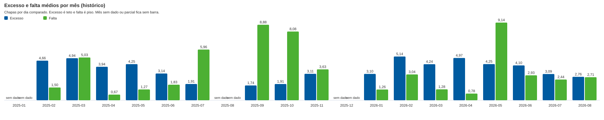
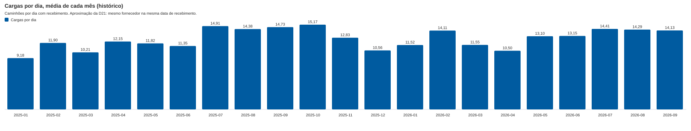

# Relatório gerencial: a equipe de funcionários sobra ou falta?

Agrovia, Franca. Preparado no hackathon UniFACEF de 03 e 04 de outubro de 2026. Todo número deste relatório traz a origem do dado (`historico`, `teste` ou `operacao`). Este arquivo está em construção: as seções marcadas "a preencher" são completadas nas próximas versões, e os números gerados por script ficam entre marcadores `gerar`.

## 1. Resposta

A conclusão abaixo é gerada pelo mesmo cálculo do painel e usa o histórico (origem: `historico`).

<!-- gerar:resposta -->
**Safra (outubro a março)** (origem: histórico)

> No período “safra (outubro a março)” houve excesso médio de 3,79 funcionários por dia, cerca de R$ 341,93 por dia em complemento; nos dias de pico, falta mediana de 14,17 funcionários.

Em 138 dias úteis comparados: 93 dias com excesso (em média 5,63 funcionários a mais, cerca de R$ 507,37 por dia); 45 dias com falta (em média 10,55 funcionários a menos, cerca de R$ 951,26 por dia).

Dias de pico: dias de maior produção estimada (10% do período, no mínimo um dia; em empate entra a data mais antiga). São 14 dias; falta média de 25,75 e mediana de 14,17 funcionários.

Estimativa do histórico: a produção vem só do recebimento de compras, sem carregamento de cooperado, remoção e transferência. O excesso é um teto e a falta é um piso.

**Entressafra (abril a setembro)** (origem: histórico)

> No período “entressafra (abril a setembro)” houve excesso médio de 3,36 funcionários por dia, cerca de R$ 303,14 por dia em complemento; nos dias de pico, falta mediana de 17,17 funcionários.

Em 200 dias úteis comparados: 132 dias com excesso (em média 5,09 funcionários a mais, cerca de R$ 459,31 por dia); 68 dias com falta (em média 11,16 funcionários a menos, cerca de R$ 1.006,43 por dia).

Dias de pico: dias de maior produção estimada (10% do período, no mínimo um dia; em empate entra a data mais antiga). São 20 dias; falta média de 26,91 e mediana de 17,17 funcionários.

Estimativa do histórico: a produção vem só do recebimento de compras, sem carregamento de cooperado, remoção e transferência. O excesso é um teto e a falta é um piso.

**Leitura:** No histórico a produção é estimada só pelo recebimento de compras: carregamento de cooperado, remoção e transferência não estão nos dados. Por isso o excesso é um TETO e a falta é um PISO. Os dois lados convivem: há dias com excesso e dias com falta, e a média líquida esconde isso.
<!-- /gerar:resposta -->

## 2. Números

<!-- gerar:numeros -->
| Período | Origem | Dias úteis comparados | Efetivo médio | Diárias justificadas médias | Excesso médio, funcionários/dia (R$/dia) | Falta média, funcionários/dia (R$/dia) | Dias com excesso / com falta | Falta mediana nos dias de pico |
|---|---|---|---|---|---|---|---|---|
| Safra (outubro a março) | histórico | 138 | 9,36 | 9,01 | 3,79 (R$ 341,93) | 3,44 (R$ 310,19) | 93 / 45 | 14,17 |
| Entressafra (abril a setembro) | histórico | 200 | 7,83 | 8,26 | 3,36 (R$ 303,14) | 3,79 (R$ 342,18) | 132 / 68 | 17,17 |
| Todo o período com dado | histórico | 338 | 8,46 | 8,57 | 3,54 (R$ 318,98) | 3,65 (R$ 329,12) | 225 / 113 | 16,68 |

Piso da diária: R$ 90,1731. Valores exibidos com 2 casas; o cálculo não arredonda. No histórico a produção é estimada só pelo recebimento de compras: carregamento de cooperado, remoção e transferência não estão nos dados. Por isso o excesso é um TETO e a falta é um PISO.
<!-- /gerar:numeros -->

### 2.1 Mês a mês

<!-- gerar:meses -->
| Mês | Situação | Dias comparados | Efetivo médio | Excesso médio (funcionários/dia) | Falta média (funcionários/dia) |
|---|---|---|---|---|---|
| 2025-01 | parcial (fora das médias) | | | | |
| 2025-02 | com dado | 19 | 9,05 | 4,66 | 1,50 |
| 2025-03 | com dado | 17 | 7,88 | 4,94 | 5,03 |
| 2025-04 | com dado | 18 | 7,17 | 3,94 | 0,67 |
| 2025-05 | com dado | 18 | 7,33 | 4,25 | 1,27 |
| 2025-06 | com dado | 18 | 6,39 | 3,14 | 1,83 |
| 2025-07 | com dado | 22 | 6,64 | 1,91 | 5,96 |
| 2025-08 | sem dado (fora das médias) | | | | |
| 2025-09 | com dado | 22 | 8,45 | 1,74 | 8,88 |
| 2025-10 | com dado | 23 | 9,35 | 1,91 | 8,08 |
| 2025-11 | com dado | 18 | 10,83 | 3,11 | 3,63 |
| 2025-12 | sem dado (fora das médias) | | | | |
| 2026-01 | com dado | 21 | 8,62 | 3,10 | 1,26 |
| 2026-02 | com dado | 18 | 10,22 | 5,14 | 3,04 |
| 2026-03 | com dado | 22 | 9,59 | 4,24 | 1,28 |
| 2026-04 | com dado | 20 | 8,45 | 4,97 | 0,78 |
| 2026-05 | com dado | 20 | 8,25 | 4,25 | 9,14 |
| 2026-06 | com dado | 19 | 8,53 | 4,10 | 2,93 |
| 2026-07 | com dado | 22 | 8,50 | 3,09 | 2,44 |
| 2026-08 | com dado | 21 | 8,33 | 2,76 | 2,71 |

Dias de folha em sábado ou domingo, fora da comparação com o recebimento: 74.
<!-- /gerar:meses -->

### 2.2 Gráficos

<!-- gerar:graficos -->

<!-- /gerar:graficos -->

### 2.3 Por armazém

<!-- gerar:armazem -->
A folha não registra o armazém de cada funcionário: o efetivo por armazém é um rateio proporcional à demanda, uma premissa, não uma medição.

Safra, histórico:

| Armazém | Diárias justificadas por dia | Parte da demanda | Efetivo rateado (premissa) |
|---|---|---|---|
| Insumos | 2,97 | 33,0% | 3,09 |
| Adubo | 5,98 | 66,4% | 6,22 |
| Pátio de Máquinas | 0,06 | 0,6% | 0,06 |
| Loja | 9,76 | sem boletim | fora da comparação |

**Medido por armazém nos boletins novos** (exato; origem em cada linha):

| Armazém | Origem | Dias | Excesso médio (funcionários/dia) | Falta média (funcionários/dia) | Complemento médio (R$/dia) |
|---|---|---|---|---|---|
| Insumos | teste | 15 | 0,26 | 0,39 | 23,33 |
| Adubo | teste | 15 | 0,45 | 0,51 | 40,19 |
| Pátio de Máquinas | teste | 15 | 0,20 | 0,51 | 17,78 |
<!-- /gerar:armazem -->

## 3. Método

### 3.1 A régua é a do próprio boletim da Agrovia

A pergunta "a equipe sobra ou falta?" é respondida com a conta que a Agrovia já paga todos os dias, não com uma conta nova (D29):

- Diárias justificadas = produção do dia ÷ piso da diária (R$ 90,1731).
- Saldo = efetivo menos diárias justificadas. Saldo positivo é **excesso** de funcionários; negativo é **falta**.
- Em reais, o excesso é o complemento de diária que a Agrovia paga sem produção correspondente: `piso × efetivo − produção`. A falta é o inverso: `produção − piso × efetivo`, o quanto a produção passou do que o efetivo cobre ao piso.
- O custo do dia é o maior entre `piso × efetivo` e a produção (D31), a mesma regra do boletim.
- Nada é arredondado no cálculo. Dinheiro, peso e quantidade usam aritmética decimal exata; o arredondamento só acontece ao exibir (duas casas).

### 3.2 Como a produção do histórico é estimada

Não existem boletins históricos. A produção de cada dia é estimada só pelo recebimento de compras (planilha de movimentação), convertida para a unidade do boletim e multiplicada pelo preço do tipo de item:

- Fertilizante: peso ÷ 50 kg, vezes o preço da saca. Demais grupos: quantidade em unidades vezes o preço da unidade.
- O armazém de cada linha segue o grupo do produto (D16); quando o grupo não está no mapa, vale o depósito.
- Só entram na comparação com a folha os armazéns que fazem boletim (D17). A Loja fica de fora.
- Corretivos de solo (calcário, gesso, dolomita) e linhas acima de 100 toneladas ficam fora da estimativa (D46, explicado na calibração abaixo). O grupo IRG fica sem preço (197 linhas, pedido 2 aberto).
- O efetivo vem da folha de funcionários: presentes menos a operação de café (D18). A folha não informa o armazém de cada funcionário, por isso o efetivo por armazém só aparece como rateio proporcional à demanda, rotulado como premissa (D30).
- Sábados e domingos, dias sem recebimento e linhas inconsistentes da folha ficam fora da comparação. Meses sem dado ou parciais ficam como lacuna, sem interpolação, e fora das médias (D20).

**Excesso é um teto e falta é um piso.** Carregamento de cooperado, remoção e transferência também geram produção no boletim, mas não existem nos dados históricos. Produção maior no mundo real significa menos excesso e mais falta do que o estimado. Por isso toda cifra histórica deste relatório e do painel vem com essa frase ao lado.

### 3.3 Calibração com o boletim de 17/11/2025

É o único boletim real disponível (armazém Adubo). Ele foi cruzado com os recebimentos do mesmo dia (origem: `historico` para o recebimento, boletim real para a referência):

| Item | Boletim (descarga) | Estimativa pelo recebimento |
|---|---|---|
| Fertilizante | 2.378 unidades (mais 400 de remoção, que não vêm de recebimento) | 2.410 sacas de 50 kg sem o calcário; 6.410 com o calcário de 200 t |
| Agroquímico | 30 unidades | 50 pacotes de 1 kg |

- Sem os corretivos, a conversão peso ÷ 50 kg fica **1,3% acima** do boletim. Com o calcário ela erra por quase três vezes. Por isso os corretivos ficam fora da estimativa.
- No agroquímico a conversão por unidade não fecha exatamente (50 contra 30). Fica registrado, sem ajuste.
- Isso é **um dia só**. É premissa de trabalho, não prova. Mais boletins reais mudariam a calibração (D29 reabre se a conversão não fechar).
- Sem o corte de 100 toneladas por linha, o fertilizante histórico somava 1,16 milhão de toneladas (55% corretivo), com dias de 2.000 a 14.000 toneladas. Algumas linhas repetem a mesma `Qtd` em várias datas (por exemplo 4.124,29 em 12 recebimentos), o que sugere a quantidade do pedido repetida no recebimento. Com o corte, o fertilizante conhecido soma cerca de 55 mil toneladas em cerca de 1.000 dias, perto de 55 toneladas por dia útil.
- Agroquímico em micro-embalagem distorce o pico: "NUFURON PCT 10 GR" com 40.000 unidades (sachês de 10 g) vira 143 diárias num único dia (08/05/2026). Por isso o relatório e o painel mostram a **mediana** da falta nos dias de pico ao lado da média.

As três regras acima estão registradas como D46 (provisória).

### 3.4 Dias de pico

Dias de pico são os 10% de maior produção estimada do período (no mínimo um dia; em empate entra a data mais antiga). Média e mediana da falta são mostradas juntas, porque poucos dias extremos puxam a média.

### 3.5 Régua complementar: a norma de funcionários

A norma (até 500 kg nenhum funcionário; acima disso, batido = 5, paletizado ou big bag = 1 com empilhadeira, máquina = 1; D25 e D26) dimensiona o dia pelo tipo de carga. No histórico não se conhece o acondicionamento (D22), então a norma só aparece como faixa de mínimo a máximo e como régua complementar. A resposta principal é a do boletim.

## 4. Premissas e conflitos adotados

As decisões numeradas estão em `docs/DECISOES.md`. As que mudam números deste relatório:

| Decisão | O que foi adotado | Efeito no número | Status |
|---|---|---|---|
| D10 | Piso de R$ 90,1731 por diária; meia diária conta 0,5 | Define diárias justificadas e o complemento | Firme |
| D17 e D46 (3) | Insumos, Adubo e Pátio de Máquinas fazem boletim; Loja não, e só eles entram na comparação com a folha | A Loja, 52% da demanda estimada na safra, fica fora; com ela, a falta média saía 13,6 funcionários por dia | Provisória |
| D18 | Efetivo = presentes menos operação de café | Café fora da conta, 9 dias na folha | Firme |
| D19 | Safra = outubro a março | Separa safra de entressafra | Provisória |
| D20 | Meses sem dado ou parciais ficam fora das médias | 2025-01 (parcial), 2025-08 e 2025-12 (sem dado) | Firme |
| D21 | Caminhão histórico = mesmo fornecedor e mesma data de recebimento | Aproximação; tende a contar mais caminhões do que o dossiê | Provisória |
| D22 | Acondicionamento só pela espécie do XML, sem inferir | Norma vira faixa no histórico | Firme |
| D29 | Régua do boletim aplicada ao dia | Define a conta principal | Provisória |
| D46 | Regras da estimativa histórica: (1) corretivos de solo ficam fora da produção; (2) linha acima de 100 t é suspeita e fica fora; (3) só armazéns com boletim entram na comparação com a folha | Sem (1) a conversão erra por quase três vezes no dia calibrado; sem (2) o fertilizante soma 1,16 milhão de toneladas | Provisória |
| D47 | Boletim único ("Todas as áreas") ou por armazém, configurável. O boletim único conta como a cooperativa inteira e não vira linha de armazém; os boletins por armazém do mesmo dia somam na cooperativa | Painel mostra a tabela "Cooperativa inteira, medido" à parte da tabela por armazém; padrão da demo é boletim por armazém (D17) | Firme (a configuração) |
| D30 | Efetivo por armazém é rateio, não medição | Tabela por armazém rotulada como premissa | Provisória |
| D31 | Custo do dia = maior entre piso × efetivo e produção | Custo estimado do histórico | Provisória |
| D42 | Importador substitui tudo e nunca descarta linha em silêncio | Contagens da seção 5 | Firme |

**Grupo IRG (irrigação) sem preço.** Pedido 2 aberto, à espera da Agrovia: o grupo não tem armazém nem linha do boletim definidos. As 197 linhas de recebimento do IRG ficam sem preço, portanto sem produção estimada, e caem no armazém do depósito. Isso é uma subestimativa da produção e reforça que a falta é um piso.

Também vale registrar três diferenças entre o dossiê e os dados: a folha mostra média de 6,0 a 10,5 funcionários por mês, não 14 a 15 na safra; o cadastro de fornecedores tem 872 linhas, não 859; e a pasta de dados traz 463 PDFs para 460 XML.

## 4.1 Limites desta análise

- O histórico é uma estimativa. Um único boletim real permitiu calibrar a conversão, e só para um dia.
- A folha não distingue armazéns: a divisão por armazém só é medida nos boletins novos (origem `teste` ou `operacao`, nunca misturada com o histórico).
- Os valores de `teste` vêm de dados sintéticos da demonstração e não representam a Agrovia.
- Faltam carregamento de cooperado, remoção e transferência no histórico, por isso o excesso é teto e a falta é piso.

## 5. Tratamento dos dados

Os dados da Agrovia chegaram sem limpeza, e o tratamento é parte do trabalho. Regra geral do importador: nenhuma linha some em silêncio. Cada linha fica na tabela com uma marca de qualidade e um indicador de "considerada" (1 entra nos indicadores, 0 fica de fora), e cada arquivo ganha uma linha de log com as contagens por motivo. Rodar a importação duas vezes dá as mesmas contagens.

### 5.1 O que foi encontrado (reconhecimento, 03/10/2026)

| Arquivo | Problema | Contagem |
|---|---|---|
| Movimentação (41.779 linhas) | Linhas inteiras duplicadas (além da primeira) | 540 |
| | Chave (pedido, item, recebimento, chave, depósito) repetida | 762 |
| | Recebimento anterior ao lançamento | 274 |
| | Recebimento em sábado (nenhum em domingo) | 21 |
| | Sem chave de acesso | 229 |
| | Chave com tamanho diferente de 44 | 114 |
| | Chave com letras | 13 |
| | Número da NF diferente do trecho da chave | 175 |
| | Sem nome do fornecedor | 7 |
| | `Peso` igual a zero | 1.845 |
| | `Qtd` fracionária | 2.172 |
| | Item fora do cadastro de produtos (4.676 itens) | 10.517 linhas |
| | Depósito que não é do item no cadastro | 4.358 |
| | Depósito fora do mapa de armazéns | 11 |
| Cadastro de produtos (10.899 linhas) | Sem peso unitário | 1.337 |
| Cadastro de fornecedores (872 linhas) | CNPJ com pontuação | 377 |
| | CNPJ repetido | 13 |
| Folha de funcionários (CSV, 428 linhas) | Meses sem dado: agosto e dezembro de 2025 | 2 meses |
| | Mês parcial: janeiro de 2025 (5 dias) | 1 mês |
| | Linhas em sábado e domingo | 72 e 2 |
| | Dias com operação de café | 9 |
| XML de NF-e (460 arquivos, 838 itens) | Sem volume | 16 |
| | Sem espécie | 73 |
| | Sem peso | 26 |
| | Sem placa | 421 |
| | Chave repetida entre arquivos | 2 |

### 5.2 Duas armadilhas que mudariam a conclusão

1. **O campo `Peso` da movimentação é o peso da nota, repetido em todas as linhas da mesma nota.** Em todos os 5.724 pedidos com NF de mais de uma linha, o `Peso` é o mesmo em cada linha. Somar o peso por linha multiplicaria o peso da nota pelo número de itens. Para itens em tonelada, o peso da linha é `Qtd` x 1.000 kg (mediana exata de 1.000 kg por unidade nas notas de uma linha). Por isso o peso da linha não sai do campo `Peso`.
2. **Há pesos impossíveis** (por exemplo, 16.016.000 kg para 16 toneladas, e 5.331.500 kg em notas de adubo). Pela D46, linha acima de 100 toneladas é marcada como `peso_suspeito` e não entra na produção estimada (3.852 linhas no histórico importado), e corretivos de solo ficam fora da produção (2.376 linhas marcadas `corretivo_fora_da_producao`). As contagens finais por arquivo estão na seção 5.4, geradas do log do importador.

### 5.3 Ordens de grandeza conferidas

- Caminhões por dia, contando fornecedor com recebimento na mesma data: mediana de 11 e máximo de 33. O dossiê fala em 5 a 6 por dia no normal e cerca de 15 no pico. A aproximação inclui peças, loja e frete fracionado, e deve ser lida como teto de caminhões.
- Funcionários presentes: a média mensal da folha vai de 6,0 a 10,5. O dossiê fala em cerca de 8 no normal e 14 a 15 na safra. A folha não confirma a média de 14 a 15 na safra (o máximo de um dia é 15).

### 5.3.1 O que cada marca faz com a linha

Nenhuma linha é apagada. A marca diz o que o painel faz com ela (D42):

| Marca | Tratamento |
|---|---|
| `duplicada` (movimentação) | Linha inteira repetida: a primeira fica, as extras ficam com `considerada = 0` |
| `chave_repetida`, `receb_antes_lancamento`, `sem_chave`, `chave_tamanho`, `chave_com_letras`, `sem_nome_fornecedor` | Linha continua considerada; a marca fica para auditoria e para o fornecedor corrigir o documento |
| `peso_suspeito` | Peso acima de 100 t por linha (D46): o peso da linha fica nulo e ela não entra na produção estimada |
| `peso_zero`, `sem_peso_linha`, `qtd_fracionaria`, `sem_unidade` | Peso ou unidade não utilizável: a linha conta como recebimento, mas fica fora do ranking de peso e, se não houver conversão, fora da produção estimada |
| `corretivo_fora_da_producao` | Calcário, gesso e dolomita (D46): fora da produção estimada, mantidos na tabela |
| `item_fora_cadastro`, `grupo_pelo_prefixo` | O grupo do item vem das três letras do código (declarado) |
| `grupo_sem_preco` (IRG) | Sem preço, sem produção estimada (pedido 2 aberto) |
| `fim_de_semana` | Sábado ou domingo: fica fora da comparação com a folha, mas é contado e mostrado |
| `cafe_maior_que_presentes` (folha) | Dia inconsistente: `considerada = 0`, fora da conta e contado à parte |
| `operacao_cafe` (folha) | Café é descontado do efetivo (D18) |
| `sem_placa`, `sem_especie`, `sem_peso`, `sem_volume`, `varios_volumes` (XML) | Campo ausente fica vazio; sem espécie, o acondicionamento não é inferido (D22) |
| `chave_repetida` (XML) | A segunda cópia fica com `considerada = 0` |

Meses sem dado ou parciais (agosto e dezembro de 2025, janeiro de 2025) ficam em tabela própria e fora das médias, sem interpolação (D20).

### 5.4 Resultado da importação (gerado do log do importador)

<!-- gerar:importacao -->
| Arquivo | Linhas lidas | Sem marca | Marcadas |
|---|---|---|---|
| 01_notas_fiscais/xml | 460 | 38 | 422 |
| 03_movimentacao/pedido_recebimento_notafiscal.xlsx | 41779 | 24733 | 17046 |
| 04_mao_de_obra/chapas_por_dia.csv | 428 | 345 | 83 |

Marcas por arquivo (linhas afetadas; uma linha pode ter mais de uma marca):

- **01_notas_fiscais/xml:** _consideradas 458; sem_placa 421; sem_especie 73; sem_peso 26; sem_volume 16; varios_volumes 3; _fora 2; chave_repetida 2
- **03_movimentacao/pedido_recebimento_notafiscal.xlsx:** _consideradas 41239; grupo_pelo_prefixo 10517; item_fora_cadastro 10517; peso_suspeito 3852; corretivo_fora_da_producao 2376; qtd_fracionaria 2172; sem_peso_linha 2147; peso_zero 1845; _fora 540; duplicada 540; receb_antes_lancamento 274; sem_unidade 272; sem_chave 229; chave_repetida 222; grupo_sem_preco 197; chave_tamanho 114; fim_de_semana 21; chave_com_letras 13; sem_nome_fornecedor 7
- **04_mao_de_obra/chapas_por_dia.csv:** _consideradas 428; fim_de_semana 74; operacao_cafe 9

Cargas históricas derivadas (mesmo fornecedor e mesma data de recebimento, D21): 11970.

Meses fora das médias: 2025-01 (parcial), 2025-08 (sem dado), 2025-12 (sem dado).
<!-- /gerar:importacao -->
